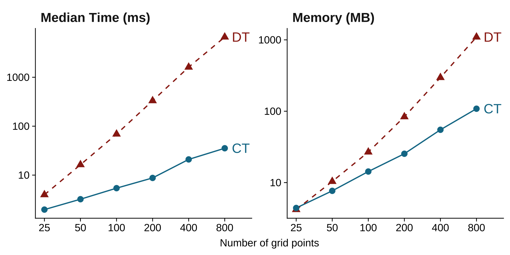
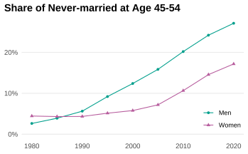
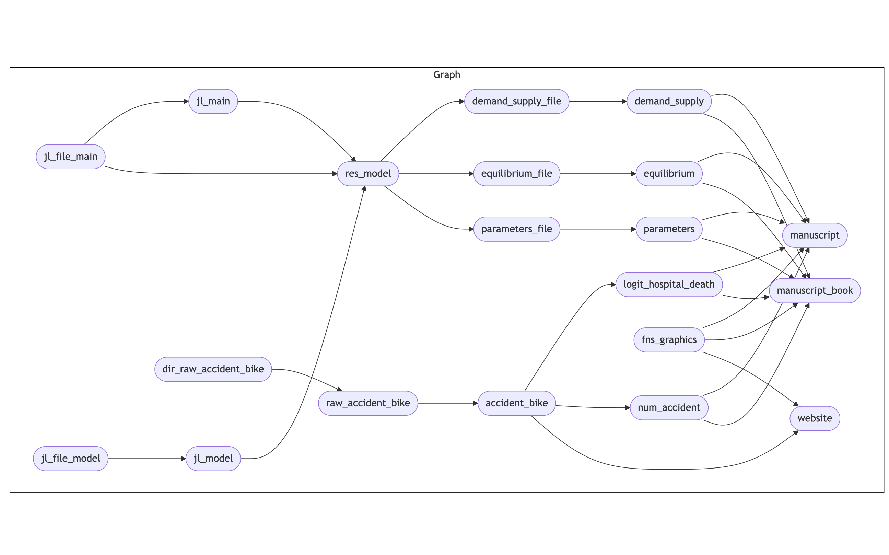

I am an associate professor (tenure track) at [Kobe University](https://www.econ.kobe-u.ac.jp/en/).

My research field is family economics, broadly speaking, I am interested in questions like:

- Why do gender wage and earning gaps still remain?
- Why does the fertility rate remain low in any country?

Ph.D. in Economics ∙ CEMFI ∙ 2025

Master in Economics and Finance ∙ CEMFI ∙ 2021

Bachelor in Economics ∙ University of Tokyo ∙ 2019

\

## WORKING PAPERS

[Marriage and Divorce in Continuous Time](../research/spruce-shark/index.llms.md)

- [ Latest WP](https://arxiv.org/abs/2602.19798)
- [ Code](https://github.com/kazuyanagimoto/spruce-shark)

[A Quantitative Model of Non-Marriage and Fertility](../research/icky-impala/index.llms.md)

Bargaining over Leisure

- [ Latest WP](https://arxiv.org/abs/2603.14758)
- [ Slides](../research/icky-impala/cigs_yanagimoto.pdf)

[See All →](../research)

## TEACHING THAT INSPIRES

[Family Macroeconomics](https://kazuyanagimoto.com/course-kobe-macro4-2025/)

Macro IV・Fall 2025・Kobe University

Quantitative analysis of Marriage, Fertitlity, and Gender Gaps

- [ Website](https://kazuyanagimoto.com/course-kobe-macro4-2025/)
- [ GitHub](https://github.com/kazuyanagimoto/course-kobe-macro4-2025)

[See All →](../teaching)

## A BLOG THAT WORKS

[Research Workflow with Quarto + {targets}](../blog/2025/0426_research_workflow/index.llms.md)

[See All →](../blog)

## TALKS THAT LAST

An Advanced Introdution to R

Jan 13, 2023 ∙ CEMFI, Madrid

Here is a talk on practical techniques to write a paper with R

- [ Slides](https://kazuyanagimoto.com/workshop-r-2022/code/slides/advancedr/)
- [ GitHub](https://github.com/kazuyanagimoto/workshop-r-2022)

[See All →](../talks)
