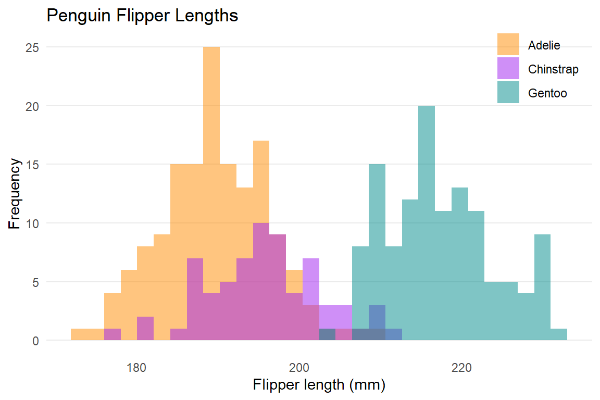
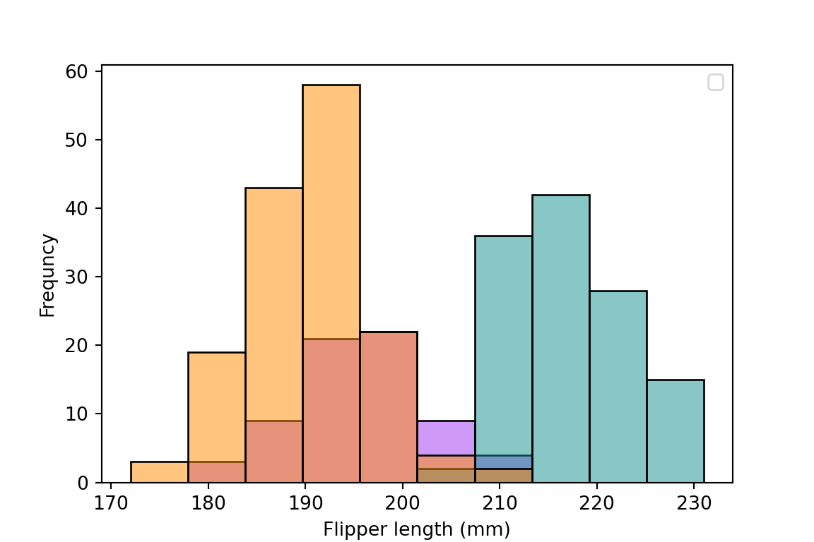
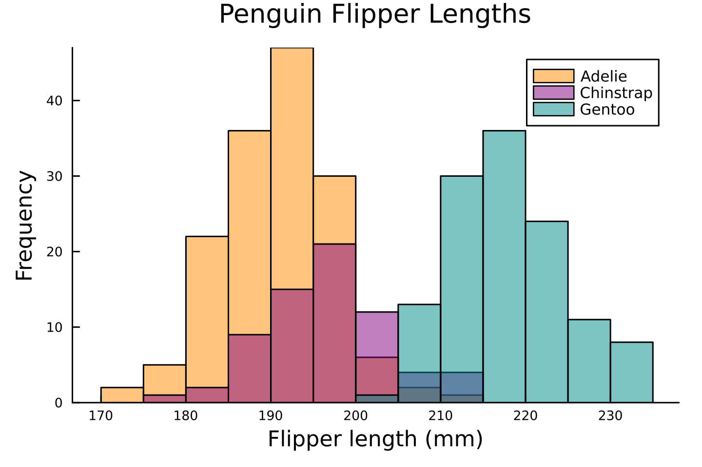
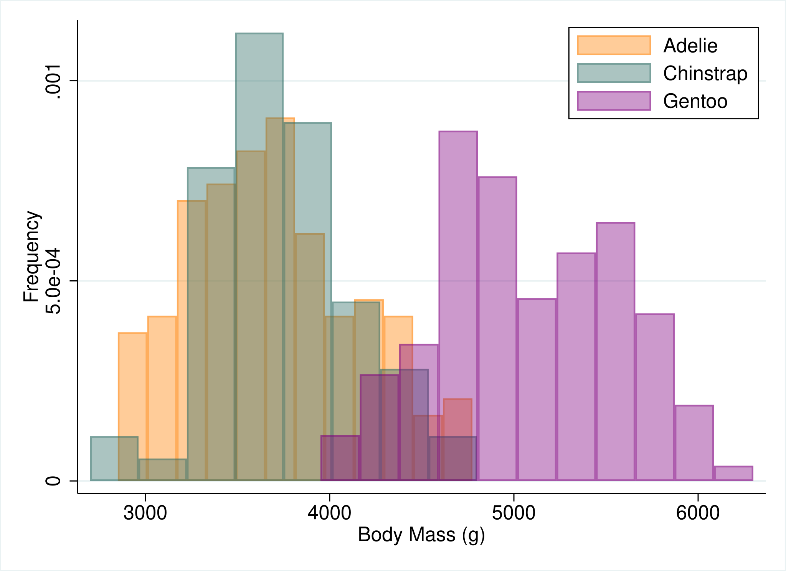
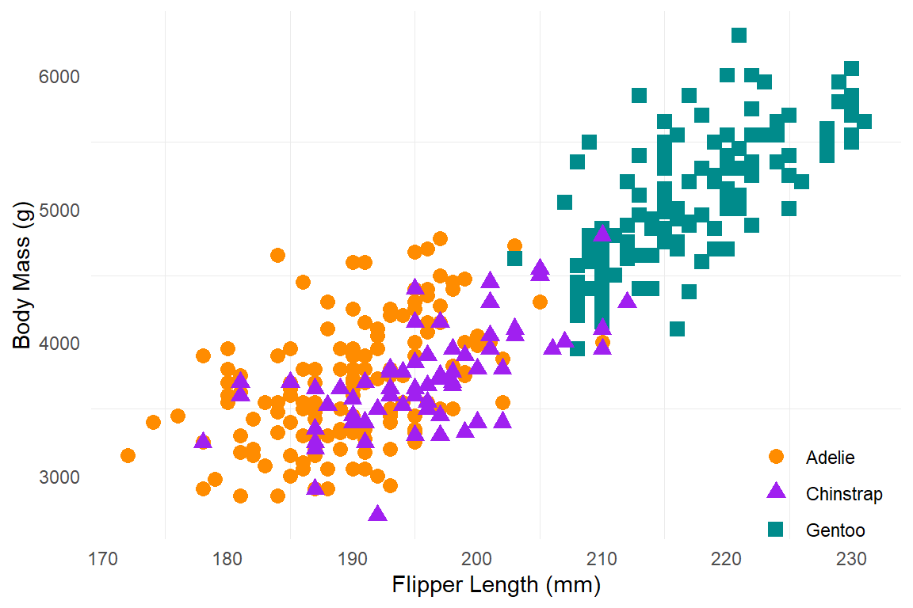
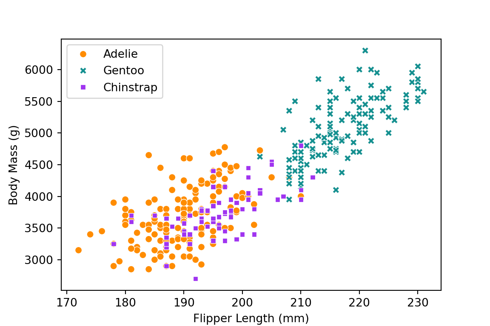
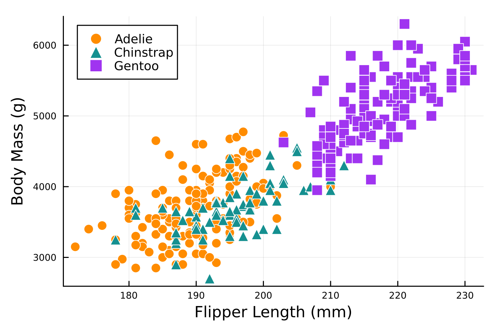
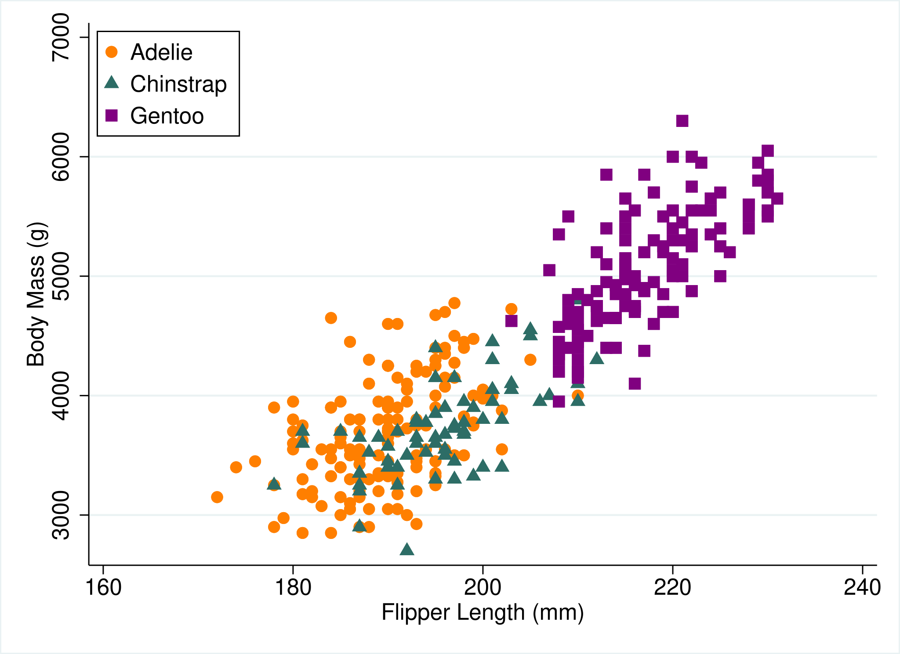

A common misunderstanding about Quarto is that we cannot use multiple languages within a document. Indeed, *Jupyter* cannot use multiple languages within a document, and we usually use the jupyter engine for Python and Julia (and it is officially supported.)

However, *knitr* has already been able to execute multiple languages tons of years ago, so why can’t we do it in Quarto?

Let’s see the following example with `palmerpenguins::penguins` of Horst et al. ([2020](#ref-horst2020))

### R

``` r
library(palmerpenguins)
library(ggplot2)

ggplot(data = penguins, aes(x = flipper_length_mm)) +
  geom_histogram(aes(fill = species), 
                 alpha = 0.5, 
                 position = "identity") +
  scale_fill_manual(values = c("darkorange","purple","cyan4")) +
  labs(x = "Flipper length (mm)",
       y = "Frequency",
       title = "Penguin Flipper Lengths",
       fill = NULL) +
  theme_minimal() +
  theme(panel.grid.major.x = element_blank(),
        panel.grid.minor = element_blank(),
        legend.position = c(0.9, 0.9))
```



### Python

To run a python code on *knitr*, `install.packages("reticulate")`

``` python
from palmerpenguins import load_penguins
import seaborn as sns
import matplotlib.pyplot as plt

penguins = load_penguins()

plt.clf()
sns.histplot(data=penguins, x='flipper_length_mm',
                hue='species', palette=['#FF8C00', '#159090', '#A034F0'])

plt.xlabel("Flipper length (mm)") 
plt.ylabel("Frequncy")
plt.legend(title = "")
plt.show()
```



### Julia

To run a julia code on *knitr*, run `install.packages("JuliaCall")`. `PalmerPenguins.load()` asks you to download the data, so you have to set `ENV["DATADEPS_ALWAYS_ACCEPT"] = true` to automatically accept it.

``` julia
using PalmerPenguins
using StatsPlots
using DataFrames
ENV["DATADEPS_ALWAYS_ACCEPT"] = true;

penguins = DataFrame(PalmerPenguins.load());

histogram(
    [penguins[penguins.species .== species, :].flipper_length_mm for species in ["Adelie", "Chinstrap", "Gentoo"]],
    label = ["Adelie" "Chinstrap" "Gentoo"],
    fillcolor = [:darkorange :purple :cyan4],
    fillalpha = 0.5,
    xlabel = "Flipper length (mm)",
    ylabel = "Frequency",
    title = "Penguin Flipper Lengths",
    legend = :topright,
    grid = false,
    legendfontsize = 7,
    legendtitle = nothing,
    bar_width = 5,
    size = (480, 320),
    dpi = 300,
    tickfontsize = 6,
    guidefontsize = 10,
    titlefontsize = 12,
    margin=Plots.Measures.Length(:mm, 2.0)
)
```



### Stata

Douglas Hemken’s [Statamarkdown](https://github.com/hemken/Statamarkdown) allows us to use Stata on Rmarkdown (so as on Quarto!)

``` r
# devtools::install_github("Hemken/Statamarkdown")
library(Statamarkdown)
haven::write_dta(penguins, here::here("blog/2023/04/30/quarto_multi_lang/palmerpenguins.dta"))
```

Thanks to `Statamarkdown`, we can easily set the working directory to the directory where the `.qmd` file exists by just calling `cd` in Stata.

``` stata
cd
```

    C:\Users\kazuh\GitHub\kazuyanagimoto.github.io\blog\2023\04\30\quarto_multi_lan
    > g

Then, you can run Stata code in a code chunk.

``` stata
use palmerpenguins.dta, clear

twoway (hist body_mass_g if species == 1, color(orange%40)) ///
  (hist body_mass_g if species == 2, color(emerald%40)) ///
  (hist body_mass_g if species == 3, color(purple%40)), ///
   xtitle("Body Mass (g)") ytitle("Frequency") ///
   legend(order(1 "Adelie" 2 "Chinstrap" 3 "Gentoo") pos(1) ring(0) col(1)) ///
   plotregion(fcolor(white)) graphregion(fcolor(white))
graph export "figure/stata/hist.svg", replace
```



But you have to manually export an image file for a plot and add it into a document…

## Tabset

I think, one of the most useful case is when you want to support multiple source codes in a textbook or lecture notes. Quarto supports [Tabset layout](https://quarto.org/docs/interactive/layout.html#tabset-panel) and it’s so smart!

## R

``` r
penguins |>
  ggplot(aes(x = flipper_length_mm, y = body_mass_g,
             color = species, shape = species)) +
  geom_point(size = 3) +
  scale_color_manual(values = c("darkorange","purple","cyan4")) +
  labs(x = "Flipper Length (mm)", y = "Body Mass (g)", color = NULL, shape = NULL) +
  theme_minimal() +
  theme(legend.position = c(0.9, 0.1),
        panel.grid.major = element_blank())
```



## Python

``` python
plt.clf()

sns.scatterplot(data=penguins, x='flipper_length_mm', y='body_mass_g',
                hue='species', style="species",
                palette=['#FF8C00', '#159090', '#A034F0'])

plt.xlabel('Flipper Length (mm)')
plt.ylabel('Body Mass (g)')
plt.legend(title = "")
plt.show()
```



## Julia

``` julia
@df penguins scatter(
  :flipper_length_mm,
  :body_mass_g,
  group = :species,
  markersize = 5,
  markershape = [:circle :utriangle :rect ],
  markerstrokecolor = :white,
  palette = ["#FF8C00", "#159090", "#A034F0"],
  xaxis = "Flipper Length (mm)",
  yaxis = "Body Mass (g)",
  size = (480, 320),
  dpi = 300,
  legendfontsize = 8,
  tickfontsize = 6,
  guidefontsize = 10,
  margin=Plots.Measures.Length(:mm, 2.0)
)
```



## Stata

``` stata
use data/palmerpenguins, clear

separate body_mass_g, by(species)
twoway scatter body_mass_g? flipper_length_mm, ///
   mcolor(orange emerald purple) mlab("") ///
   msymbol(O T S) ///
   xtitle("Flipper Length (mm)") ytitle("Body Mass (g)") ///
   legend(order(1 "Adelie" 2 "Chinstrap" 3 "Gentoo") pos(11) ring(0) col(1)) ///
   plotregion(fcolor(white)) graphregion(fcolor(white))
qui graph export "figure/stata/scatter.svg", replace
```

\` 

Have a happy Quarto life 🥂!

## References

Horst, Allison Marie, Alison Presmanes Hill, and Kristen B Gorman. 2020. *Palmerpenguins: Palmer Archipelago (Antarctica) Penguin Data*. Manual. <https://doi.org/10.5281/zenodo.3960218>.
