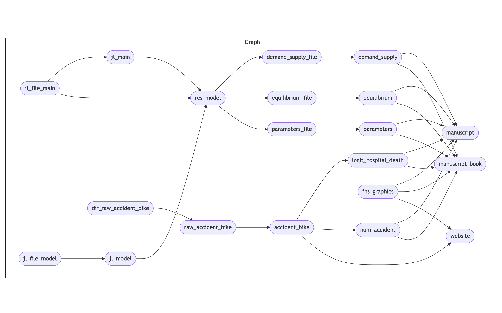
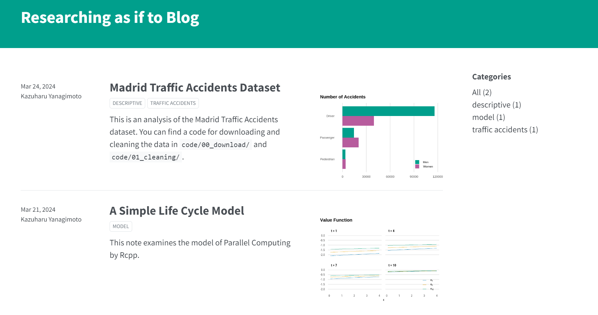
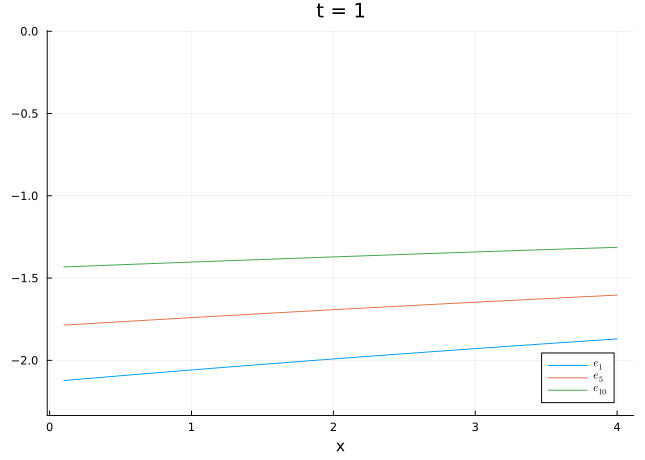
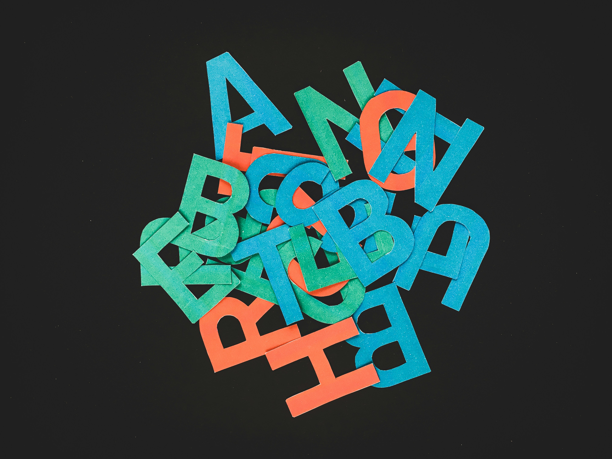
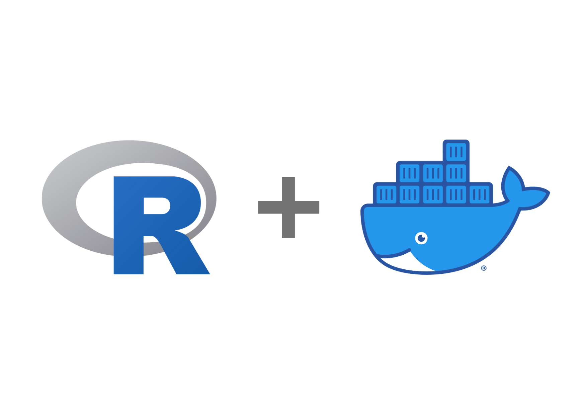

## 2025

April 26, 2025

[Research Workflow with Quarto + {targets}](../blog/2025/0426_research_workflow/index.llms.md)

## 2024

April 29, 2024

[A Gamechanger of Creating Tables in R: tinytable](../blog/2024/04/29/index.llms.md)

April 5, 2024

[Researching as if to Blog](../blog/2024/04/05/index.llms.md)

## 2023

September 6, 2023

[A Minimal & Portable Research Environment with Docker](../blog/2023/09/06/docker_template/index.llms.md)

June 10, 2023

[Scientific Communication with Quarto: Economic Models](../blog/2023/06/10/quarto_com_model/index.llms.md)

April 30, 2023

[Quarto Is Multi-lingual!](../blog/2023/04/30/quarto_multi_lang/index.llms.md)

## 2022

December 28, 2022

[Some Quarto Tips for Academic Presentation](../blog/2022/12/27/quarto_tips/index.llms.md)

May 24, 2022

[My Docker Template for R](../blog/2022/05/24/docker_template/index.llms.md)

