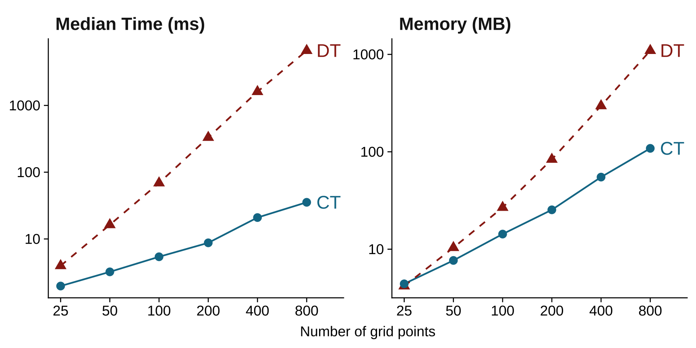
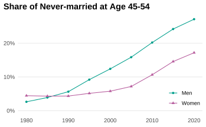
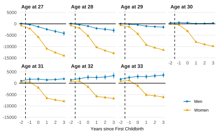
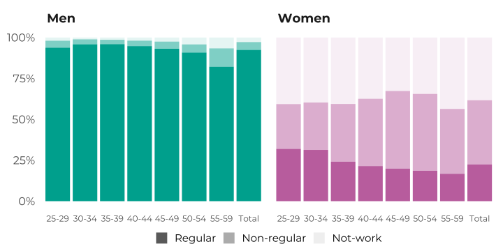

## WORKING PAPERS

[Marriage and Divorce in Continuous Time](../research/spruce-shark/index.llms.md)

- [ Latest WP](https://arxiv.org/abs/2602.19798)
- [ Code](https://github.com/kazuyanagimoto/spruce-shark)

[A Quantitative Model of Non-Marriage and Fertility](../research/icky-impala/index.llms.md)

Bargaining over Leisure

- [ Latest WP](https://arxiv.org/abs/2603.14758)
- [ Slides](../research/icky-impala/cigs_yanagimoto.pdf)

[On Causal Inference with Model-Based Outcomes](../research/hetero2wfe/index.llms.md)

with [Dmitry Arkhangelsky](https://sites.google.com/view/dmitry-arkhangelsky/) and [Tom Zohar](https://tomzohar.com/)

- [ Latest WP](https://arxiv.org/abs/2403.19563)
- [ CEMFI WP](https://www.cemfi.es/ftp/wp/2503.pdf)
- [ Tutorial](https://github.com/kazuyanagimoto/tutorial-ayz)

[Barriers to Gender Convergence](../research/common-cheetah/index.llms.md)

The Interactive Effects of Job Inflexibility and Social Norms

- [ Latest WP](https://arxiv.org/abs/2603.20817)
- [ CEMFI WP](https://www.cemfi.es/ftp/wp/2405.pdf)
- [ Slides](../research/common-cheetah/grips_yanagimoto.pdf)

[COVID-19, Food Relief, and Social Distancing](../research/bayan-bayanihan/index.llms.md)

Evidence from the Bayan Bayanihan Program in the Philippines

with [Christopher James Cabuay](https://portal.pep-net.org/public/researcher/12756) , [Yasuyuki Sawada](https://sites.google.com/site/yasuyukisawadapage) , Elaine Tan , Arturo Martinez, Jr. , Daniel Boller , Joseph Albert Nino Bulan , Ron Lester Durante , and Soyoka Okumura

- [ SSRN WP](https://doi.org/10.2139/ssrn.5256485)
