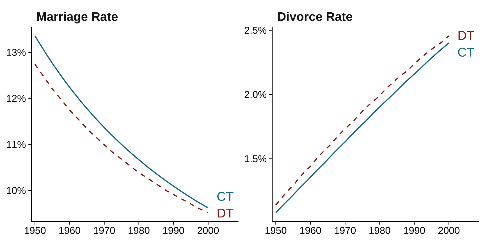
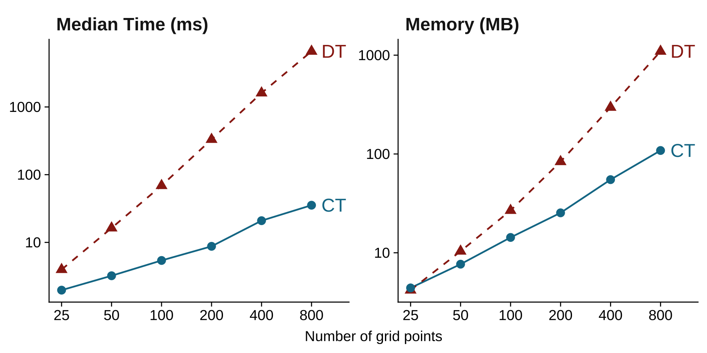

# Marriage and Divorce in Continuous Time

Marriage

Divorce

Computational Methods

Author

Affiliation

[Kazuharu Yanagimoto](https://kazuyanagimoto.com/) [](mailto:yanagimoto@econ.kobe-u.ac.jp) [![]()](https://orcid.org/0009-0007-1967-8304)

Kobe University

Published

February 23, 2025

Modified

November 17, 2026

- [ Latest WP](https://arxiv.org/abs/2602.19798)
- [ Code](https://github.com/kazuyanagimoto/spruce-shark)

## Abstract

This paper reformulates the Greenwood and Guner (2009) marriage and divorce model in continuous time using the HACT methods of Achdou et al. (2022). Replacing the AR(1) match quality process with an Ornstein-Uhlenbeck process yields a tridiagonal generator, reducing the computational complexity of both the value function and stationary distribution calculations from quadratic to linear in the number of grid points. The continuous-time model closely replicates the discrete-time equilibrium across all key outcomes, including the share of married households, the marriage rate, and the divorce rate, while achieving substantial gains in computation time and memory usage.

## Important figures

[](img/fig-marriage-divorce-rate-1.png "Replication of Fig. 7 in Greenwood and Guner (2009).")

Replication of Fig. 7 in Greenwood and Guner (2009).

[](img/fig-benchmark-1.png "Computational Performance of Continuous-Time and Discrete-Time Methods")

Computational Performance of Continuous-Time and Discrete-Time Methods

## BibTeX citation

``` bibtex
@misc{yanagimoto2026,
  title = {Marriage and Divorce in Continuous Time},
  author = {Yanagimoto, Kazuharu},
  year = {2026},
  eprint = {2602.19798},
  archiveprefix = {arXiv},
  doi = {10.48550/arXiv.2602.19798}
}
```
