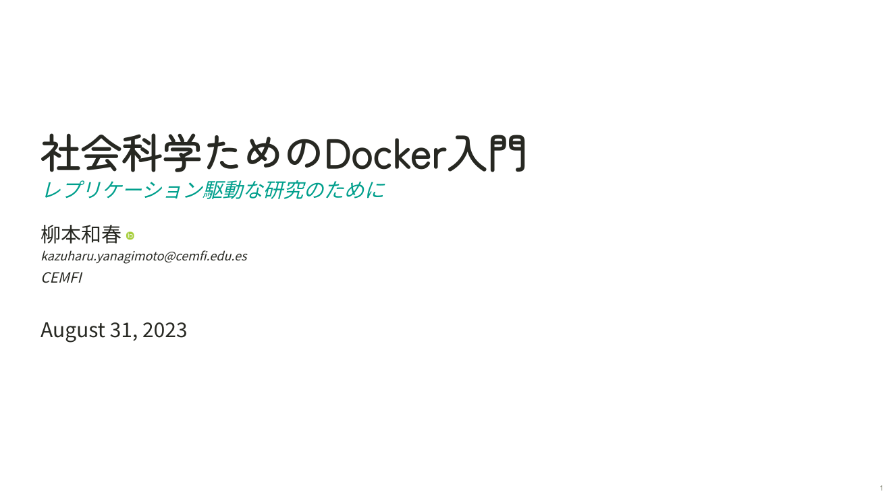
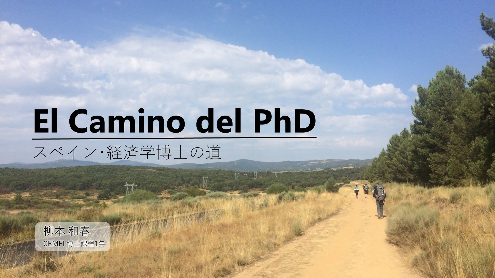
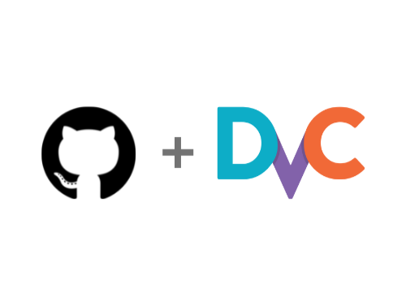

> **NOTE:**
>
> Except where noted, all content is Kazuharu Yanagimoto and licensed under [Creative Commons](https://creativecommons.org/licenses/by-sa/4.0/).

## 2026

Empiricist’s Workflow

August 18, 2026 ∙ 神戸大学

実証研究に使えるモダンなツールやワークフローを紹介しました

- [ Website](https://kazuyanagimoto.com/workshop-graduate-2026/)
- [ GitHub](https://github.com/kazuyanagimoto/workshop-graduate-2026)

## 2023

社会科学のためのDocker入門

August 31, 2023 ∙ RA Bootcamp, 湘南国際村

VSCodeを用いたDockerによる環境構築の方法についてレクチャーしました

- [ Slides](https://kazuyanagimoto.com/rabootcamp-docker-2023/)
- [ GitHub](https://github.com/kazuyanagimoto/rabootcamp-docker-2023)

Non-designer's Quarto Presentation

March 4, 2023 ∙ Tokyo.R (via zoom)

第104回Tokyo.RにてQuartoによるRevealjsスライドのデザインについてお話しました

- [ Slides](https://kazuyanagimoto.com/quarto-slides-example/code/slides/tokyor_quarto_slides)
- [ Code](https://github.com/kazuyanagimoto/quarto-slides-example/blob/main/code/slides/tokyor_quarto_slides/index.qmd)

An Advanced Introdution to R

January 13, 2023 ∙ CEMFI, Madrid

Here is a talk on practical techniques to write a paper with R

- [ Slides](https://kazuyanagimoto.com/workshop-r-2022/code/slides/advancedr/)
- [ GitHub](https://github.com/kazuyanagimoto/workshop-r-2022)

## 2022

Git & GitHub Workshop

September 23, 2022 ∙ CEMFI, Madrid

Here is a talk I gave on managing codes and data by using GitHub and DVC for economists

- [ Slides](https://kazuyanagimoto.com/github-workshop2022/)
- [ GitHub](https://github.com/kazuyanagimoto/github-workshop2022)

El Camino del PhD

July 10, 2022 ∙ 東京大学 (via Zoom)

米国大学院学生会主催の[海外大学院留学説明会@東京大学](https://gakuiryugaku.net/seminar/3162)で所属する[CEMFI](https://www.cemfi.es/)での生活についてお話しました

- [ Video](https://youtu.be/8Rj5W5pg63o?t=3178)

## 2021

Git & GitHub Workshop

September 24, 2021 ∙ CEMFI

Here is a talk I gave on managing codes and data by using GitHub and DVC for economists

- [ Slides](https://kazuyanagimoto.com/github-workshop/)
- [ GitHub](https://github.com/kazuyanagimoto/github-workshop)
